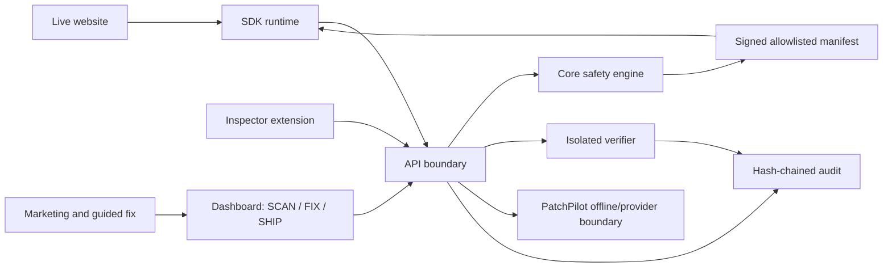

# PATCHWORK


PATCHWORK fixes a live website in 60 seconds: **SCAN** the real surface, **FIX** one reversible thing, and **SHIP** behind evidence, canary controls, and one-click undo.

## What the demo proves

| Mandatory capability | User-visible proof | Automated evidence |
| --- | --- | --- |
| Visual patching | Guided fix, patch editor, before/after operation | Dashboard route contracts and patch workflow tests |
| Smart element tracking | Confidence signals, moved/ambiguous target outcomes | 200 resolver scenarios and mutation fixtures |
| Collaboration | Review inbox, named owners, conflict decision | API collaboration and conflict tests |
| Isolated preview | Private preview state before public traffic | Verifier report and preview API |
| Automated verification | Interaction, visual, accessibility, console, network checks | Stored verifier evidence and replay tests |
| Versioned ship and rollback | Signed release, canary, health boundary, rollback time machine | Release lifecycle and rollback benchmark |
| Audit trail | Hash chain, tamper test, CSV handoff | Audit verification and export tests |

## Quick start

Requirements: Node.js 22.13 or newer.

```bash
npm install
npm run demo
```

Open [http://localhost:3000/web](http://localhost:3000/web), [http://localhost:3000/fix](http://localhost:3000/fix), or [http://localhost:3000/dashboard?view=overview](http://localhost:3000/dashboard?view=overview). The supervisor runs the unified UI on port 3000 and the seeded API on port 8787.

Useful gates:

```bash
npm run demo:reset
npm run typecheck
npm run lint
npm run test
npm run performance
npm run screenshots
npm run playwright
npm run ai:eval
npm run judge
npm run loc
```

## Architecture



Read [ARCHITECTURE.md](ARCHITECTURE.md), [API.md](API.md), and [THREAT_MODEL.md](THREAT_MODEL.md) for the boundaries and failure modes.

## Performance evidence

The seeded local benchmark currently records 4.08 ms API read p95 across 32 reads, 18.78 ms rollback request-to-restore time, 7.2 KB SDK gzip, zero screenshot console errors, and a 0.02 reserved-layout CLS baseline. `npm run performance` writes the raw capture to `docs/evidence/performance.json` and the dashboard Evidence page exposes the same values. The measured mobile Lighthouse scores are 57/100/100 on landing and 49/96/100 on dashboard for performance/accessibility/best practices; performance remains below the 90 target and is not presented as green.

The repository’s current handwritten LOC is intentionally below the eventual size gates. `npm run loc` is the source of truth; generated screenshots, bundles, assets, and dependencies are excluded.

## PatchPilot

PatchPilot is evidence-constrained. It can explain a finding, summarize release risk, draft an allowlisted operation, and propose an inverse-aware review card. It cannot publish, rollback, delete, inject scripts, or bypass human approval. The local demo uses the deterministic offline provider; a server-side provider adapter can be enabled without changing the safety boundary.

## Security model

Patchwork operations are typed, allowlisted, same-origin checked, content hashed, signed, expiry-bound, and reversible. The API keeps secrets server-side, rate-limits requests, uses request IDs and idempotency keys, rejects SSRF/private targets, and appends state-changing events to a tamper-evident audit chain.

## Limitations and roadmap

Current limitations are explicit: Lighthouse performance is below target, the local target storefront is an inert deterministic fixture, remote model credentials are not included, live mutation requires the installed SDK handshake and human approval, and the final 25,000+ LOC gates are not yet met. The next roadmap tranche is package depth, production persistence, production-server performance tuning, richer browser coverage, and authenticated provider integrations.

## Contributing

See [CONTRIBUTING.md](CONTRIBUTING.md). Every change should preserve a runnable demo, add a real test or evidence artifact, and keep the next safe action legible.
